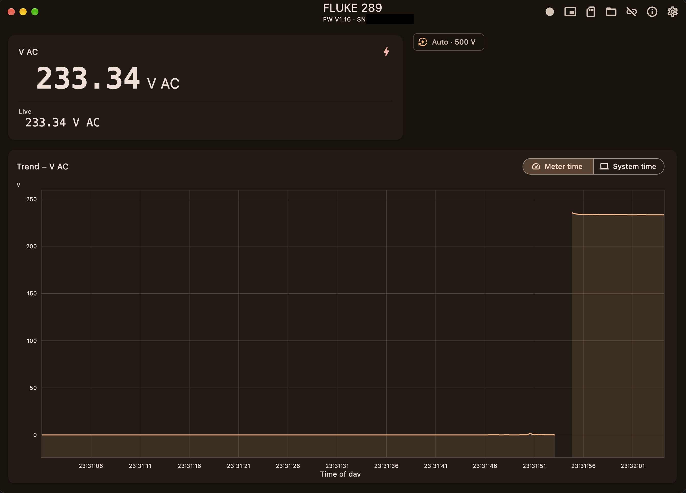
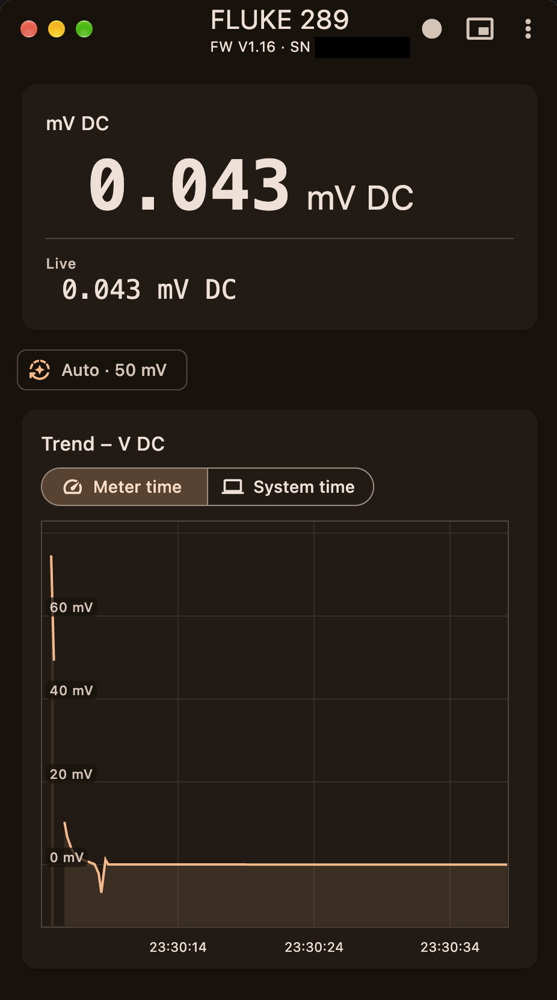

# Multimeter Viewer

Live readings and recordings for multimeters – compatible with the Fluke 287
and 289.

The app connects to the meter through its IR USB cable or a self-built
Bluetooth IR adapter and shows the readings live. It runs on macOS,
Windows, Linux, Android and in the browser (Chrome/Edge; USB only).

<p>
  
  
</p>

## Features

- **Live view:** primary and secondary reading, min/max/avg, range, modes
  and a history chart; by the meter's clock or the system time.
- **Device selection:** finds connected meters automatically; on Android a
  single meter is connected right away.
- **Recordings:** with name, identifier, comment and duration; zoomable
  chart and CSV export.
- **Meter memory:** reads recordings, min/max and peak sessions and saved
  readings stored in the meter; recordings can be charted and exported as
  CSV.
- **Compact view:** small always-on-top window (desktop) or
  picture-in-picture (Android).
- **German/English**, light and dark theme.

CSV files are in English regardless of the app language: metadata as
`# Key: Value` lines, then one reading per row.

## Setup

**macOS:** `brew install libusb`. The build embeds libusb into the app.

**Android:** requires USB host/OTG. Building needs the Android SDK with NDK
and CMake 3.22.1; libusb is built from `android/app/src/main/cpp/`.

**Web:** Chrome and Edge only, over HTTPS or localhost.

## Signing

Android release builds are signed with the key in `android/key.properties`
(never commit it or the keystore). Without that file they use the debug key,
which is only good for testing: such an APK cannot update an installed app
signed with another key.

```sh
PASSWORD=$(openssl rand -hex 24)
keytool -genkeypair -keystore release.jks -alias release -keyalg RSA \
  -keysize 4096 -validity 10000 -storepass "$PASSWORD" -dname "CN=Multimeter Viewer"
```

Keep `release.jks` and the password safe outside of GitHub: without them, no
updates for installed apps are possible.

For a local build, create `android/key.properties`:

```properties
storeFile=/path/to/release.jks
storePassword=<password>
keyAlias=release
keyPassword=<password>
```

For GitHub Actions, add the repository secrets `ANDROID_KEYSTORE_BASE64`
(`base64 -i release.jks`), `ANDROID_KEYSTORE_PASSWORD` and `ANDROID_KEY_ALIAS`.
Pull requests always use the debug key.

## Limitations

- On macOS, Apple's FTDI driver may claim the cable; connecting then fails.
- iOS is not supported.

## Bluetooth IR adapter

A self-built adapter: an ESP32 with an IR LED and an IR phototransistor
that connects the meter wirelessly to a smartphone or PC, or over USB while
it is plugged in; the app finds it automatically. Circuit, firmware and 3D
models are in a separate repository.‚

## Adding another meter

The code is split into three layers:

- `lib/adapters/`: transports (USB, Bluetooth LE). They only find devices and
  pass bytes. Each device class attaches the filters of the devices it wants
  with `attachFilter` and detaches them with `detachFilter`.
- `lib/meter/`: the data the app works with and the interfaces it uses
  (`MeterDiscovery`, `MeterProtocol`, `MeterLink`, `MeterCapabilities`).
- `lib/devices/`: one folder per kind of device. A device class takes the
  adapters as parameters and is the discovery for that device, e.g.
  `FlukeDevice(usb: usb, ble: ble)`.

For another meter, add a folder in `lib/devices/`: implement `MeterProtocol`
and `MeterLink`, declare what the meter can do as `MeterCapabilities` (measurement
modes and features, each with subfunctions and whether the app can set them),
convert the answers to the types in `lib/meter/model/`, write a device class like `lib/devices/fluke/fluke_device.dart` and add it in
`lib/devices/devices.dart`.

## Disclaimer

This is an unofficial application, not made, supported or endorsed by Fluke
Corporation. It is provided "as is", without warranty of any kind (see
[LICENSE](LICENSE)). Readings shown, recorded or exported may be incomplete,
delayed or wrong. Do not rely on this app for safety-relevant measurements
or decisions – always check the meter itself. Use at your own risk.

## References

- Memory commands based on [dmm_util](https://github.com/fvaleur/dmm_util)
  and [fluke-28x-dmm-util](https://github.com/N0ury/dmm_util) (both MIT).
- USB: [unified_usb](https://github.com/irii/unified_usb.dart) (libusb,
  WebUSB) and [libusb](https://libusb.info) (LGPL 2.1).

## License

MIT – © 2026 Ivan Radeljak – see [LICENSE](LICENSE).
Source code: https://github.com/irii/multimeter-viewer
Third-party licenses: [THIRD_PARTY_NOTICES.md](THIRD_PARTY_NOTICES.md)

## Trademarks

Fluke is a trademark of Fluke Corporation. This project is not affiliated
with or endorsed by Fluke Corporation. The name is used only to identify the
compatible devices.
