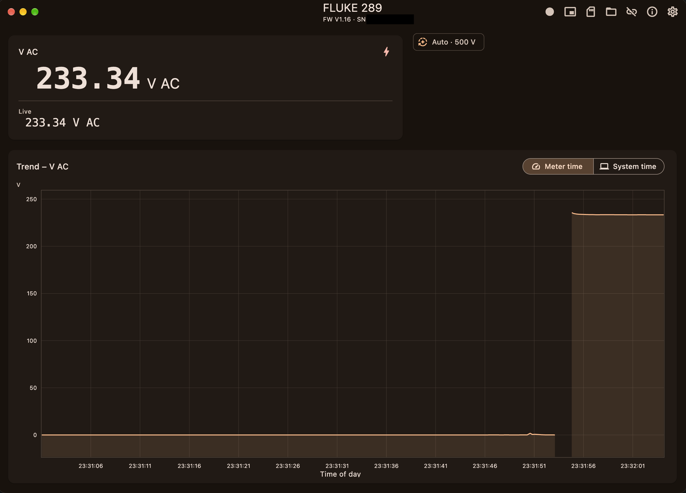
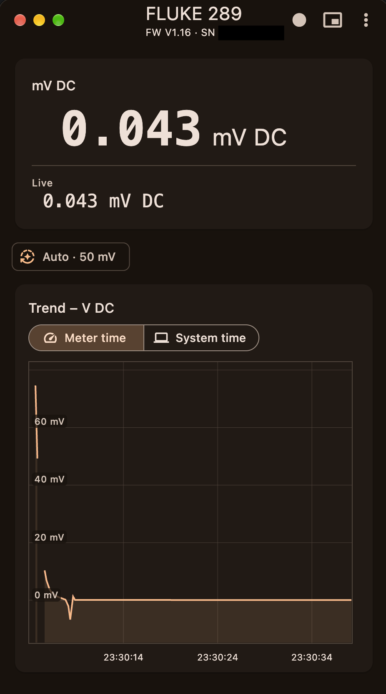

# Multimeter Viewer

Live readings and recordings for multimeters – compatible with the Fluke 287
and 289.

The app connects to the meter through its IR USB cable and shows the
readings live. It runs on macOS, Windows, Linux, Android and in the browser
(Chrome/Edge).

  
  

## Features

- **Live view:** primary and secondary reading, min/max/avg, range, modes
  and a history chart; by the meter's clock or the system time.
- **Device selection:** finds connected meters automatically; on Android a
  single meter is connected right away.
- **Recordings:** with name, identifier, comment and duration; zoomable
  chart and CSV export.
- **Meter memory:** reads recordings, min/max and peak sessions and saved
  readings stored in the meter; recordings can be charted and exported as
  CSV.
- **Compact view:** small always-on-top window (desktop) or
  picture-in-picture (Android).
- **German/English**, light and dark theme.

CSV files are in English regardless of the app language: metadata as
`# Key: Value` lines, then one reading per row.

## Setup

**macOS:** `brew install libusb`. The build embeds libusb into the app.

**Android:** requires USB host/OTG. Building needs the Android SDK with NDK
and CMake 3.22.1; libusb is built from `android/app/src/main/cpp/`.

**Web:** Chrome and Edge only, over HTTPS or localhost.

## Limitations

- On macOS, Apple's FTDI driver may claim the cable; connecting then fails.
- iOS is not supported.

## Disclaimer

This is an unofficial application, not made, supported or endorsed by Fluke
Corporation. It is provided "as is", without warranty of any kind (see
[LICENSE](LICENSE)). Readings shown, recorded or exported may be incomplete,
delayed or wrong. Do not rely on this app for safety-relevant measurements
or decisions – always check the meter itself. Use at your own risk.

## References

- Memory commands based on [dmm_util](https://github.com/fvaleur/dmm_util)
  and [fluke-28x-dmm-util](https://github.com/N0ury/dmm_util) (both MIT).
- USB: [unified_usb](https://github.com/irii/unified_usb.dart) (libusb,
  WebUSB) and [libusb](https://libusb.info) (LGPL 2.1).

## License

MIT – © 2026 Ivan Radeljak – see [LICENSE](LICENSE).
Source code: https://github.com/irii/multimeter-viewer
Third-party licenses: [THIRD_PARTY_NOTICES.md](THIRD_PARTY_NOTICES.md)

## Trademarks

Fluke is a trademark of Fluke Corporation. This project is not affiliated
with or endorsed by Fluke Corporation. The name is used only to identify the
compatible devices.
